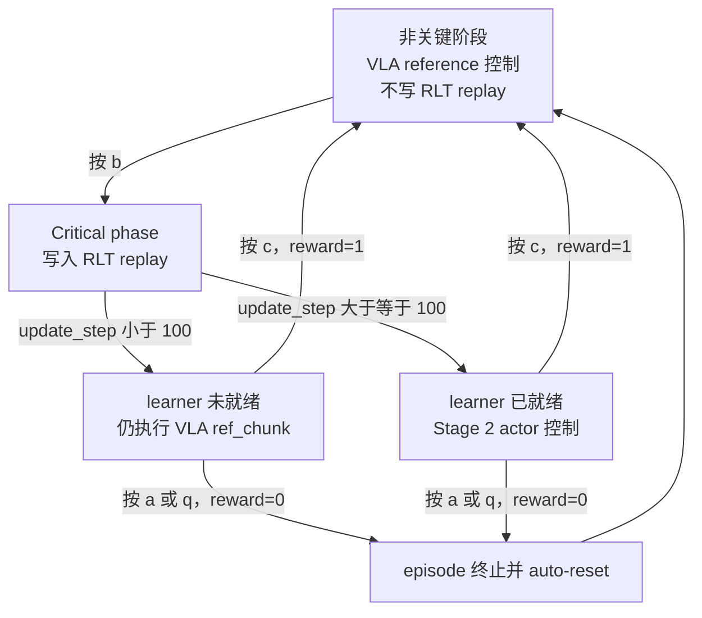

# Zadai RLT Stage 2 按键与状态切换

本文记录 `zadai_200_rlt_stage2_ac_mlp` 真机训练中的键盘操作、控制权切换、奖励和 replay 行为。操作前请确认急停可用，并让机器人处于安全初始姿态。

## 快速操作表

| 按键 | 事件 | 切换后的状态 | Reward | 是否结束当前 RLT segment | 是否结束并重置 Gym episode |
|---|---|---|---:|---|---|
| `b` | `enter_actor` | `rlt_switch_flags=True`，进入 critical phase | 0 | 否 | 否 |
| `b`（已处于 critical phase） | `actor_already_active` | 保持 `rlt_switch_flags=True` | 0 | 否 | 否 |
| `c` | `success` | `rlt_switch_flags=False`，控制权返回 VLA reference | 1 | 是 | 否 |
| `a` | `failure` | `rlt_switch_flags=False` | 0 | 否 | 是 |
| `q` | `abort` | `rlt_switch_flags=False` | 0 | 否 | 是 |

`a` 和 `q` 对训练的数值结果相同：reward 为 0，并终止当前 Gym episode。两者仅保留不同的事件名，便于区分任务失败和操作员主动中止。

## 状态机



## `b` 键的两层含义

按下 `b` 后，wrapper 将 `rlt_switch_flags` 设为 `True`。从下一次路由决策开始，该阶段的 transition 会设置：

```text
record_transition=True
```

实际动作来源还取决于 learner 是否就绪：

| 条件 | 实际发送给机器人的动作 | `actor_switch` | 是否写入 replay |
|---|---|---|---|
| 尚未按 `b` | OpenPI `ref_chunk` | `False` | 否 |
| 已按 `b`，但 `update_step < 100` | OpenPI `ref_chunk` | `False` | 是 |
| 已按 `b`，且 `update_step >= 100` | Stage 2 actor action | `True` | 是 |

当前配置要求 replay buffer 至少收集 250 条 transition，learner 才开始 warmup 更新。这里一条 transition 对应一个完整的 30-step action chunk，而不是一个低层控制步：

```yaml
algorithm:
  rlt_schedule:
    warmup_min_size: 250
    warmup_post_collect_updates: 100
```

因此，第一次按 `b` 通常只是开始收集 critical-phase 数据，不代表随机初始化的 Stage 2 actor 会立即控制机器人。

## `c` 键：成功并返回 VLA

在 critical phase 成功完成目标时按 `c`：

```text
reward=1
rlt_segment_done=True
rlt_switch_flags=False
terminated=False
```

这会把当前 RLT segment 标记为成功终点，供 replay TD target 使用，但不会结束物理机器人 episode。下一份 observation 和 action chunk 从当前位置继续，由 VLA reference policy 接管。

## `a` 与 `q`：失败或主动中止

按 `a` 表示任务失败，按 `q` 表示操作员主动中止。两者都会产生：

```text
reward=0
terminated=True
rlt_switch_flags=False
```

因为当前环境设置了 `auto_reset: True`，Gym episode 随后进入 reset 流程。Zadai 环境会调用对应的回零/重置逻辑，并等待配置中的 `reset_wait_s`。

正常情况下，一个 Gym episode 最长为 9000 个 30 Hz 低层步，即 5 分钟。runner
仍然每 300 个低层步结束一次采集 epoch、写入 replay 并训练；warmup 完成后每个
runner global step 执行 8 次 critic 更新，并按 4:1 比例执行约 2 次 actor 更新，
即使该轮没有新增 critical transition 也会从已有 replay 采样。延长 episode 不会让
learner 等 5 分钟才更新。`a`、`q`、环境终止或安全异常仍可提前结束 episode。

## 按键生效时机

键盘 wrapper 在一次 `env.step(action)` 完成后读取按键。因此，本次已经提交的低层动作不会被刚按下的键撤回；新状态用于后续 observation、路由和 action chunk。每个键有 0.2 秒独立防抖，长按或快速重复按键不会在防抖窗口内重复触发。

调用环境 `reset()` 时会：

- 将 `rlt_switch_flags` 恢复为 `False`；
- 清空各键防抖时间；
- 丢弃尚未消费的按键事件。

## VLAHost 人工干预与键盘切换的区别

键盘负责标记 RLT critical phase、成功和失败。VLAHost 的 intervention session 是另一条独立路径：

- `intervene_flag=True` 表示 VLAHost 报告发生了人工干预；
- `executed_action` 记录真正执行的人工动作；
- RLinf 会用 `executed_action` 替换该位置原来的 OpenPI/actor 动作；
- actor 的 BC loss 在干预位置学习人工动作，未干预位置仍学习 OpenPI `ref_chunk`；
- 只有已经按 `b`、即 `record_transition=True` 的 chunk 才进入当前 RLT replay；
- 脚踏干预本身不会自动进入 critical phase，也不会自动赋予成功或失败 reward；
- 它不会代替 `b`、`c`、`a`、`q` 对 RLT segment 状态的标记。

### 30 步 chunk 的发送与干预恢复

当前 Zadai 配置使用：

```yaml
override_cfg:
  step_frequency: 30.0
  action_transport: chunk

actor:
  model:
    num_action_chunks: 30
    ref_num_action_chunks: 30
```

RLinf 每次推理得到 30 个低层动作后，一次性通过 VLAHost
`POST /action_chunk` 提交；随后仍逐步读取 30 次 `/state`，用于保存逐步
observation、人工干预标记和实际执行动作。chunk 在 VLAHost 中以 30 Hz 播放，
RLinf 不会再对同一块重复发送 30 次 `POST /action`。

### Stage 2 动作限制

Stage 2 actor 仍输出完整的 `30 x 16` 绝对动作 chunk，并未改成 residual
策略。为避免刚切换到 actor 时出现大跳变，当前配置按以下三层约束动作：

| 约束层 | 当前值 | 作用 |
|---|---:|---|
| Actor 第 1 个动作相对 OpenPI reference | 手臂每维 `0.02` normalized（约 `0.063 rad`），夹爪 `0` | 只限制 RL 接管瞬间的第一个目标；第 2–30 个 actor 动作不做 reference 投影 |
| 相邻低层动作 | 手臂每步 `0.1 rad` | 限制发送给 VLAHost 的相邻绝对关节目标变化 |
| 整个 30-step chunk | 手臂累计 `0.5 rad` | 每个目标都相对本次推理时的实测关节位置裁剪，防止小步变化在 chunk 内累积成大漂移 |

最后两层不限制夹爪（配置值为 `null`）。第一个动作的夹爪偏差为 `0`，因此
接管瞬间沿用 OpenPI 夹爪目标；后续夹爪动作不做 reference 投影。Actor 更新中的
Q 查询和 target Q 同样只投影 chunk 的第一个动作，使训练和部署一致。BC 项仍
作用于 actor 的完整原始 chunk。

Replay 会保存经过本地物理限制、实际提交给 VLAHost 的动作；发生人工干预的
位置随后仍以 VLAHost 返回的人工执行动作为准。该规则只影响新采集的数据，
已经保存在 replay 目录里的历史 transition 不会被追溯改写。

脚踏按下时，VLAHost 接管控制并丢弃尚未执行的旧 policy chunk。脚踏松开后，
VLAHost 进入 `waiting_policy`，不会继续执行干预前的旧动作。RLinf 完成当前块的
状态采样并再次推理后，会提交带有最新 `observation_generation` 的新 chunk；
VLAHost 接受该块后切回 policy。因此，松开脚踏后恢复最多可能等待当前 30 步块
的剩余时间加一次推理时间，通常约为 1 秒加推理耗时，而不是立即恢复。

运行日志中的 `action_chunk_submit` 事件可用于检查 `chunk_id`、`execution` 和
`observation_generation`。正常连续执行时 `execution` 为 `active`；脚踏释放后的
首个有效新块通常为 `resume_pending`。如果持续出现 `shadow`，应检查 RLinf 从
`/state` 读取到的 `intervention.refresh_generation` 是否继续更新。

## 运行时确认

重点观察以下指标：

| 指标 | 含义 |
|---|---|
| `train/replay/record_transition_rate` | 当前 rollout 中写入 RLT replay 的比例 |
| `train/replay/actor_switch_rate` | 实际由 Stage 2 actor 控制的比例 |
| `train/rlt/ready_for_online` | learner 是否已允许 actor 上线 |
| `train/replay_buffer/size` | replay 中已有的 transition 数量 |
| `train/replay/reward_mean` | replay reward 均值 |
| `train/replay/intervention_rate` | 实际发生人工干预的比例 |
| `train/action_ref_abs_mean` | reference 投影后、真正参与 Q 优化的平均动作偏差 |
| `train/action_ref_raw_abs_mean` | 投影前 actor 原始输出与 reference 的平均偏差 |

推荐按以下顺序操作：

1. 启动时保持非关键阶段，由 VLA reference 控制。
2. 到达需要强化学习的关键阶段时按 `b`。
3. 成功完成当前关键阶段时按 `c`。
4. 明确失败时按 `a`；需要安全中止整个 episode 时按 `q`。
5. 在 `train/rlt/ready_for_online=1` 之前，不要把 `b` 后仍执行 VLA reference 误判为切换失效。

## Replay 跨重启保存

Zadai Stage 2 会异步增量保存每批 replay，并在下一次启动时自动加载：

```yaml
algorithm:
  replay_buffer:
    auto_save: True
    auto_resume: True
    auto_save_path: ${oc.env:ZADAI_REPLAY_BUFFER_PATH,/home/zzx23457/code_xlb/RLinf/replay_buffers/zadai_200_rlt_stage2}
```

单 actor 的实际数据位于上述目录的 `rank_0/` 子目录。启动日志出现
`Resumed replay buffer`，且首个指标表中的 `replay_buffer/total_samples`
大于零，表示预加载成功。需要从空 buffer 重新开始时，应先停止训练，再把
`ZADAI_REPLAY_BUFFER_PATH` 指向一个新的空目录；不要在 worker 写入期间删除文件。

## 对应实现

- 键盘状态与奖励：`rlinf/envs/realworld/common/wrappers/keyboard_rlt_policy_switch_wrapper.py`
- Actor/VLA 路由：`rlinf/algorithms/rlt/route.py`
- Zadai 环境：`rlinf/envs/realworld/zadai/zadai_env.py`
- Stage 2 配置：`examples/embodiment/config/zadai_200_rlt_stage2_ac_mlp.yaml`
