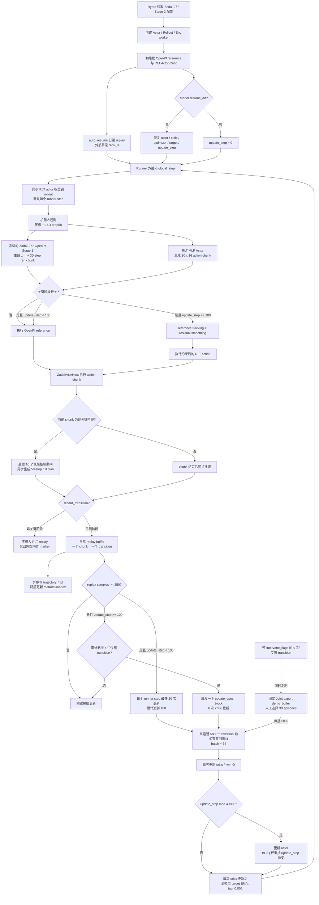

# Zadai-277 RLT Stage 2 训练结构与运行逻辑

本文对应当前主仓库中的
[`zadai_200_rlt_stage2_ac_mlp.yaml`](../examples/embodiment/config/zadai_200_rlt_stage2_ac_mlp.yaml)。
文件名仍保留 `zadai_200`，但其 Stage 1 权重、OpenPI data config、实验名和 replay
路径均已切换到 Zadai-277。

## 1. 当前结构图



### 1.1 RLT MLP Actor 的实际输入

Actor 不直接读取图像。图像、任务文本和状态先经过冻结的 OpenPI Stage 1，再组成：

| 输入 | 当前形状 | 来源与含义 |
| --- | ---: | --- |
| `ref_chunk` | `30 x 16 = 480` | OpenPI 生成的归一化 joint reference chunk |
| `z_rl` | `2048` | OpenPI prefix hidden states 经已训练 RLT token module 编码的视觉-语言特征 |
| `proprio` | `16` | 当前双臂 14 个 joint 与 2 个 gripper 状态 |

三者展平拼接成 `480 + 2048 + 16 = 2544` 维 Actor 输入，经过三层 256 维
Tanh MLP，输出 `30 x 16 = 480` 维 action mean。训练时使用固定标准差
`0.002` 采样后做 `tanh`；评估时使用确定性的 mean action。

Critic 的状态输入不包含 `ref_chunk`，而是 `z_rl + proprio = 2064` 维，再与待评估的
480 维 action chunk 一起送入 twin-Q head。

### 1.2 runner step、VLAHost 和 replay trajectory

一个 **runner step** 是 `EmbodiedRunner` 的一次最外层训练循环，不是一个机器人低层控制点。
当前一次 runner step 依次执行：

1. 同步 actor 权重到 rollout；
2. 收集一次 rollout；
3. 接收并写入符合条件的 replay transition；
4. 根据 schedule 执行 0~20 次梯度更新；
5. `global_step += 1`，再判断是否评估或保存 checkpoint。

当前 `max_steps_per_rollout_epoch=900`、`num_action_chunks=30`，所以一次 runner step
最多包含 30 次策略推理/action chunk，每个 chunk 又由 VLAHost 以 30 Hz 执行 30 个低层
action。只有被关键阶段开关选中的 chunk 才进入 RLT replay。

OpenPI flow matching 使用原生的 `num_steps=10`。在非关键阶段，env 会在当前 chunk
还剩 10 个低层控制点时发送观测与 `chunk_id/executed_horizon/delay_steps`。OpenPI 在
VLAHost 继续播放当前 chunk 时生成完整 50-step plan，并复用 RTC approximate guidance
约束它与上一条 full plan 的重叠部分。到边界后跳过已经过期的前 10 步，执行
`full_plan[10:40]`，因此 VLAHost 仍收到完整 30-step chunk，不会提前抢占当前 chunk。
`rtc_inference_ms`、实际切片起点和 guidance 标志随 rollout result 返回并进入运行指标。

关键阶段保持 chunk 末端观测后的同步推理，使用 `full_plan[0:30]`，避免 RLT actor 使用
预取时的旧观测。若按键在非关键 chunk 的预取触发后才切入 critical，已生成的 reference
chunk 仍会执行一次，随后恢复 critical 同步路径；这会让 actor 接管最多晚一个 chunk，
但不会让旧 actor chunk 在退出 critical 后继续执行。

`http://127.0.0.1:8010` 是 RLinf 连接 VLAHost 的 HTTP 服务地址。`127.0.0.1` 表示
VLAHost 与 RLinf 在同一台机器；Zadai env 通过 `/state` 读取机器人和相机状态，通过
`/action_chunk` 提交 30 步动作，并通过 `/go_home` 重置。若 VLAHost 在另一台机器，使用：

```bash
export ZADAI_VLAHOST_URL=http://<VLAHost机器IP>:8010
```

当前每条 replay trajectory 正好只有一个 transition，是因为 real-world RLT ingest 会遍历
rollout 中每个 `record_transition=True` 的 action chunk，为它单独创建
`Trajectory(max_episode_length=1)`，并填入该 chunk 的 `curr_obs -> action -> next_obs`。
通用 replay buffer 支持多 transition trajectory，但当前 real-world adapter 有意拆成一条
trajectory 对应一个关键 chunk，便于窗口采样和独立落盘。

当整个 runner step 都没有 `record_transition=True` 时，env 不再把 30 个 chunk 的图像、
`z_rl` 和 `ref_chunk` 完整序列化给 actor，而只发送一个空 `Trajectory` marker。marker 只用于
保持 Ray channel 的收发次数一致，actor ingest 后新增 transition 数为 0。

## 2. 训练启动与恢复

### 2.1 首次启动

推荐在仓库根目录启动：

```bash
cd /home/xlb/data/code/code_new/code_xlb/RLinf
source .venv_openpi/bin/activate
CUDA_VISIBLE_DEVICES=0 \
  bash examples/embodiment/run_embodiment.sh \
  zadai_200_rlt_stage2_ac_mlp
```

当前默认资源和数据位置：

| 项目 | 当前值 |
| --- | --- |
| Stage 1 reference checkpoint | `/home/xlb/data/checkpoints/zadai_277_rlt_stage1/global_step_20000/actor` |
| norm stats | `/home/xlb/data/checkpoints/zadai_277_rlt_stage1/norm_stats.json` |
| OpenPI config | `pi05_zadai_ybs_joint_277` |
| LeRobot repo id | `zadai_277_rlinf_v21` |
| 日常 replay | `/home/xlb/data/replay_buffers/zadai_277_rlt_stage2/rank_0` |
| VLAHost | `http://127.0.0.1:8010`，可用 `ZADAI_VLAHOST_URL` 覆盖 |

`validate_cfg()` 会为未显式设置的 `runner.weight_sync_interval` 补默认值 `1`，
因此当前是每个 runner step 开始时同步一次 actor 权重。

初始化顺序是：

1. Hydra 合并并校验配置，创建 cluster 和 worker groups。
2. rollout 和 env worker 初始化完成后，初始化 actor worker。
3. actor 创建在线模型、target 模型、优化器和 replay buffer。
4. `auto_resume=True` 时，优先从独立日常 replay 目录恢复已有数据。
5. 如果设置 `runner.resume_dir`，再恢复训练 checkpoint 中的模型、优化器、target
   和 `update_step`。
6. 进入同步的 `rollout -> ingest -> train -> checkpoint` 外循环。

### 2.2 正确续训

只恢复 replay 不等于续训：如果没有 `runner.resume_dir`，模型和 `update_step`
仍会从头开始。完整续训必须同时保留：

- 独立日常 replay 目录；
- 对应的 `global_step_N` checkpoint；
- 新的日志输出目录，避免覆盖旧运行记录。

示例：

```bash
cd /home/xlb/data/code/code_new/code_xlb/RLinf
source .venv_openpi/bin/activate
export EMBODIED_PATH="$PWD/examples/embodiment"
export PYTHONPATH="$PWD:${PYTHONPATH:-}"

python examples/embodiment/train_embodied_agent.py \
  --config-path "$PWD/examples/embodiment/config" \
  --config-name zadai_200_rlt_stage2_ac_mlp \
  runner.logger.log_path=/home/xlb/data/logs/zadai_277_rlt_resume \
  runner.resume_dir=/path/to/zadai_277_rlt_stage2_ac_mlp/checkpoints/global_step_N
```

checkpoint 的 `update_step` 已持久化到：

```text
actor/sac_components/training_state/checkpoint_rank_0.pt
```

旧 checkpoint 没有该文件时不会报错，但 `update_step` 会保持初始值，重新执行
100 次策略 warmup 更新。

## 3. Warmup 与策略切换

Warmup 有两个不同门槛：

| 门槛 | 当前值 | 含义 |
| --- | ---: | --- |
| `warmup_min_size` | 250 | 至少收集 250 个关键阶段 transition 才开始训练 |
| `warmup_post_collect_updates` | 100 | 至少完成 100 次 critic update 才允许 RLT actor 控制机器人 |

一个 replay transition 是一个完整的 `30 x 16` action chunk，不是单个 30 Hz
低层控制点。关键阶段开关决定 `record_transition`，并且这一记录行为不受 actor
是否 ready 影响。因此前 250 个 transition 是由 OpenPI reference 实际执行、用于
给 RLT actor/critic 冷启动的数据。

实际时间线：

```text
replay < 250
  只收集关键阶段数据；执行 OpenPI；不更新梯度

replay >= 250, update_step = 0
  第 1 个训练轮：20 critic + 5 actor update，update_step -> 20
  第 2 个训练轮：20 critic + 5 actor update，update_step -> 40
  第 3 个训练轮：20 critic + 5 actor update，update_step -> 60
  第 4 个训练轮：20 critic + 5 actor update，update_step -> 80
  第 5 个训练轮：20 critic + 5 actor update，update_step -> 100

下一个 runner step
  同步 version=100；关键阶段开始允许 RLT actor 控制

在线阶段
  每累计新增 4 个关键 transition，增加一个 8-update block
  单个 runner step 最多执行 20 次，剩余 update budget 后续补齐
```

这里 `max_updates_per_train_step=20` 防止达到 250 条数据时一次性执行全部
100 次更新，避免真实机器人主循环长时间停顿。

两个容易误解的配置行为：

- `algorithm.replay_buffer.min_buffer_size=100` 在启用 RLT schedule 后被 dataloader
  readiness 改成 `1`；真正的训练门槛由 `warmup_min_size=250` 控制。
- `train_actor_steps=100` 不控制当前 RLT schedule 路径。RLT 从第 0 次 critic update
  就允许 actor 按 `critic_actor_ratio` 更新，但 rollout 在累计 100 次更新前不会执行
  actor action。

## 4. 日常 replay 与专家/demo buffer

### 4.1 当前日常 replay

当前启用固定 Joint expert demo buffer，默认从
`/home/xlb/data/replay_buffers/zadai_9_16_joint_expert_30/rank_0` 加载；可用
`ZADAI_277_DEMO_BUFFER_PATH` 覆盖。每个训练 batch 固定包含 50% 日常 replay 和 50%
expert demo。

日常 replay 的进入条件和内容：

1. OpenPI 生成 `z_rl` 和 `ref_chunk`，RLT actor 同时产生候选 action。
2. 非关键阶段执行 OpenPI，且不记录 transition。
3. 关键阶段无论处于 warmup 还是在线阶段都会记录。
4. 每条记录包含 `curr_obs`、`next_obs`、执行 action chunk、30 步 reward、终止标志、
   reference chunk 和 intervention 标志等。
5. critic target 使用 chunk 内折扣 reward 总和，并以 `gamma^30` bootstrap 下一状态 Q。

采样逻辑：

- `sample_window_size=500`：只在最近 500 条 trajectory 中采样；当前每条 trajectory
  正好是一个 transition，因此等价于最近 500 个关键 chunk。
- 在窗口内按 sample 均匀、有放回随机采样。
- `global_batch_size=64`、`micro_batch_size=64`、单 actor rank，所以每次更新采 64 条，
  gradient accumulation 为 1。
- `cache_size=500`：最近 500 条扁平 trajectory 常驻内存；cache miss 再从磁盘读取。

### 4.2 OpenPI reference 不等于 demo buffer

当前冻结的 Zadai-277 OpenPI 是 reference policy：它每次 rollout 都生成 `ref_chunk`，
用于 warmup 控制、BC target、安全投影和 residual tracking。独立 demo buffer 来自
`9_16_zadai_joint_clean` 中人工选出的 30 个成功 episode，经同一 Stage1 checkpoint
提取 `z_rl/ref_chunk` 后物化为 RLinf replay。

当前 BC target 为：

- 普通 transition：拟合 OpenPI 的 `ref_chunk`；
- `intervene_flags=True` 的位置：拟合实际人工/专家执行 action。

人工/专家实际接管后，transition 构建器还会在相同的 chunk step 上，用
`intervene_action` 替换缓存 `curr_obs.ref_chunk` 的对应位置。这样 replay 中的执行
action、BC reference 和人工标记保持一致；未接管的位置仍保留原 OpenPI reference。

### 4.3 固定 demo buffer

当前 `algorithm.demo_buffer` 配置为 mapping：

- 可以通过 `load_path` 加载离线专家数据；
- 在线收到的 intervention transition 会同时进入日常 replay 和 demo buffer；
- 每个训练 batch 固定取 50% 日常 replay、50% demo；
- 两个 buffer 都达到各自 `min_buffer_size` 后 dataloader 才返回数据。

这意味着 intervention 数据既可能从日常 replay 被抽到，又固定占 demo 半批，属于有意的
专家数据过采样。当前 50:50 比例写死在 `ReplayBufferDataset` 中，不能只通过 YAML
调整。

30 个 Joint expert episode 的标注与导出命令：

```bash
python toolkits/marvin/label_eef_rl_demo_buffer.py annotate \
  --dataset /home/xlb/data/Data/lerobot/9_16_zadai_joint_clean/videos \
  --annotations /home/xlb/data/annotations/zadai_9_16_joint_expert_30.json \
  --max-expert-episodes 30

python toolkits/marvin/label_eef_rl_demo_buffer.py export \
  --dataset /home/xlb/data/Data/lerobot/9_16_zadai_joint_clean \
  --annotations /home/xlb/data/annotations/zadai_9_16_joint_expert_30.json \
  --output /home/xlb/data/replay_buffers/zadai_9_16_joint_expert_30/rank_0 \
  --stage1-checkpoint /home/xlb/data/checkpoints/zadai_277_rlt_stage1/global_step_20000/actor \
  --norm-stats /home/xlb/data/checkpoints/zadai_277_rlt_stage1/norm_stats.json \
  --action-space joint \
  --expected-episodes 30
```

标注窗口按 `E` 将当前完整 episode 设为成功 expert，再按 `N` 保存并前进。导出器会在
加载大模型前校验恰好选中 30 个 episode，并在落盘前用 RLinf `TrajectoryReplayBuffer`
实际加载和采样一次生成结果。

## 5. 梯度更新频率与损失

### 5.1 Warmup 后的更新频率

当前设置：

```text
train_every_runner_step = false
train_every_transitions = 4
update_epoch = 8
critic_actor_ratio = 4
target_update_freq = 1
```

所以达到 `update_step >= 100` 后：

- 每累计新增 4 个关键 transition，调度 8 次 critic optimizer step；
- 没有新增关键 transition 时不产生新的更新预算；
- actor 在 `update_step % 4 == 0` 时更新，每个 8-update block 通常更新 2 次；
- target model 每次 critic update 都执行一次 EMA；
- 若一次 rollout 新增较多数据或存在历史积压，单个 runner step 仍受
  `max_updates_per_train_step=20` 限制，剩余预算在后续 runner step 补齐。

这是严格的数据量驱动调度：`N=4`，每个 block 为 8 次 critic 更新，对应名义上的
2 critic updates / 新 transition。这里的“更新一次”指触发一个 `update_epoch=8` block，
不是只执行一个 optimizer step。

### 5.2 当前目标函数

Critic：

```text
Q target = discounted_chunk_reward + gamma^30 * (1 - done) * min(Q1', Q2')
critic loss = MSE([Q1, Q2], Q target)
```

Actor：

```text
update_step < 100:
  actor loss = -0.0 * Q1(constrained_action) + 5.0 * BC

update_step 100..499:
  BC weight 从 5.0 线性降到 2.5
  Q weight 从 0.0 线性升到 0.1

update_step >= 500:
  actor loss = -0.1 * Q1(constrained_action) + 2.5 * BC
```

其他当前启用的稳定化设置：

- twin-Q target 取 `min(Q1, Q2)`；actor objective 使用 Q1；
- fixed actor std `0.002`；
- entropy alpha 固定为 `0.0`；
- actor 输入 reference dropout `0.5`；
- actor 和 critic gradient clipping 均为 `10.0`；
- target 全模型 EMA，`tau=0.005`；
- 首个 action 相对 reference 最大偏差 `0.02`，两个 gripper 偏差固定为 0；
- joint reference tracking、residual 限幅、时间滤波和边界 blend；
- critic 训练和 actor Q 查询使用与部署一致的 action constraint。

## 6. Buffer 落盘与 checkpoint

当前存在两层持久化。

### 6.1 独立日常 replay：主数据源

路径：

```text
/home/xlb/data/replay_buffers/zadai_277_rlt_stage2/rank_0/
├── trajectory_<id>_<model_weights_id>.pt
├── metadata.json
└── trajectory_index.json
```

每次 `add_trajectories()`：

1. 使用线程池异步保存每条 `trajectory_*.pt`；
2. 内存中立即更新 index、counter、size 和 cache；
3. 等本批 trajectory 文件完成后，异步刷新 `metadata.json` 和
   `trajectory_index.json`；
4. 下次启动时，`auto_resume()` 看到 `metadata.json` 就恢复索引，并预载最近 cache。

因此进程被强制终止时，可能出现“trajectory 文件已经写完，但 metadata/index 尚未刷新”的
尾部 orphan 文件。旧索引仍然可恢复，但最后少量数据可能不在索引中。

### 6.2 Runner checkpoint：模型一致性快照

`save_interval=30` 表示每 30 个 runner global step 保存一次，不是每 30 个低层控制步。
当前每轮最多 900 个 30 Hz 低层 step，纯执行时间约 30 秒；真实耗时还包括关键阶段同步
推理、训练、重置和人工操作，因此 30 个 runner step 约为 15 分钟量级，仍应以日志中的
实际 wall-clock 为准。

checkpoint 包含：

```text
global_step_N/actor/
├── model + actor optimizer + critic optimizer + LR schedulers
└── sac_components/
    ├── target_model/checkpoint_rank_0.pt
    ├── training_state/checkpoint_rank_0.pt   # update_step
    └── replay_buffer/rank_0/                 # replay 快照
```

恢复时，如果独立日常 replay 已通过 `auto_resume` 加载且非空，会跳过 checkpoint 内较旧的
replay，避免用旧快照覆盖更新的数据。模型、优化器、target 和 `update_step` 仍从
`runner.resume_dir` 恢复。

建议把独立 replay 视为数据事实源，把 runner checkpoint 视为训练状态事实源；续训时二者
必须成对保存和记录。

## 7. 可选择的优化 trick

### 7.1 当前已启用的优化

1. **按新增 transition 驱动更新。**
   当前 `N=4`，每新增 4 个关键 chunk 触发 8 次 critic 更新；无新增数据则不增加预算。

2. **启用 actor BC/Q 权重调度。**
   前 100 次 update 使用纯 BC；随后 400 次 update 将 `BC: 5.0 -> 2.5`、
   `Q: 0.0 -> 0.1`，降低早期 Q exploitation。

### 7.2 其他无需改代码的选择

1. **按有效数据量调整 replay window。**
   当前只看最近 500 个关键 chunk。任务分布稳定时可以扩到 `1000~5000`，降低短期相关性；
   若策略和场景变化快则保留小窗口。`cache_size` 可小于 window，缺失部分按需读盘。

2. **接入高质量 demo buffer。**
   对插扎带这类稀疏成功任务，少量成功示范或人工干预通常比单纯提高在线更新次数更有效。
   先验证 intervention 标记和 action 对齐，再启用 50:50 混采。

3. **调整 policy delay。**
   当前每 4 次 critic 更新 1 次 actor。若 Q 尚不稳定可提高到 6~8；若 Q 已稳定且 actor
   学习过慢可降到 2。用 `q_data`、`q_pi`、actor/critic grad norm 和真实成功率判断。

4. **调整 target EMA。**
   当前每次 critic 更新以 `tau=0.005` 更新全模型。Q 抖动明显时降低 tau；若 target 滞后
   明显，可试 `target_update_type=q_head_only`，让非 Q 参数直接跟随 online model。

5. **开启 replay prefetch。**
   磁盘 cache miss 成为训练瓶颈时，可设置 `replay_buffer.enable_preload=true` 和合适的
   `prefetch_size`。当前 batch 全在最近 500 条 cache 内时收益通常有限。

### 7.3 需要改代码或先做实验验证

1. **可配置 demo/replay 比例。** 当前固定 50:50；建议只在 demo 量和质量差异明显时增加
   YAML 比例参数。
2. **优先级 replay。** 可按 TD error、成功、人工干预或稀有关键状态加权，但必须限制
   importance bias，避免只记住少数极端 transition。
3. **success/failure 分层采样。** 对稀疏奖励通常比通用 PER 更可解释，可保证每批含一定
   比例的成功/接近成功 chunk。
4. **原子化 metadata/index。** 用临时文件加 `os.replace()`，并在启动时扫描 orphan
   trajectory，可提高意外断电后的恢复完整性。
5. **checkpoint/replay 配对 manifest。** 记录 checkpoint global step、update step、replay
   counter 和最后 trajectory id，启动时拒绝明显错配的组合。

下一步优先监控数据驱动更新后的 Q/BC 和真实成功率，再决定是否引入成功 demo；最后才考虑
PER 或新的 loss。

## 8. 需要持续监控的指标

| 指标 | 用途 |
| --- | --- |
| `rlt/global_min_replay_size` | 是否达到 250 条 warmup 门槛 |
| `rlt/update_step` | learner 更新总数和 rollout readiness |
| `rlt/updates_to_run` / `pending_update_budget` | 是否长期积压或过度更新 |
| `rlt/critic_updates_run` / `actor_updates_run` | 实际 critic/actor 更新比例 |
| `critic/q_data`, `actor/q_pi` | Q 值是否漂移或爆炸 |
| `actor/bc_loss`, `bc_ref_loss`, `bc_human_loss` | actor 对 reference/人工动作的拟合 |
| `actor/human_mask_ratio` | intervention 数据占比 |
| `actor/action_ref_abs_mean` | 约束后动作偏离 reference 的程度 |
| `replay/reward_positive_rate` | replay 中正奖励密度 |
| `replay_buffer/total_samples` | 日常 replay 实际规模 |

## 9. 代码依据

- 启动和 runner 外循环：[`embodied_runner.py`](../rlinf/runners/embodied_runner.py)
- RLT route 与 warmup 控制：[`route.py`](../rlinf/algorithms/rlt/route.py)
- RLT transition、调度和 loss：[`fsdp_rlt_ac_policy_worker.py`](../rlinf/workers/actor/fsdp_rlt_ac_policy_worker.py)
- SAC optimizer、target 和 checkpoint：[`fsdp_sac_policy_worker.py`](../rlinf/workers/actor/fsdp_sac_policy_worker.py)
- replay/demo 混采：[`embodied_buffer_dataset.py`](../rlinf/data/embodied_buffer_dataset.py)
- replay 采样和落盘：[`replay_buffer.py`](../rlinf/data/replay_buffer.py)
